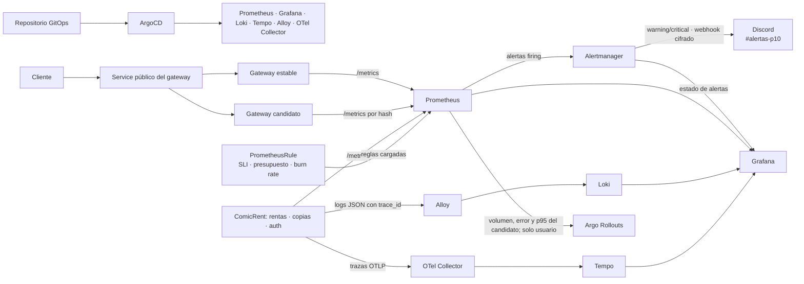
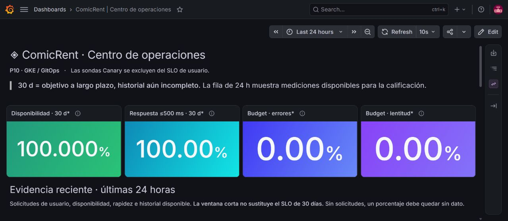
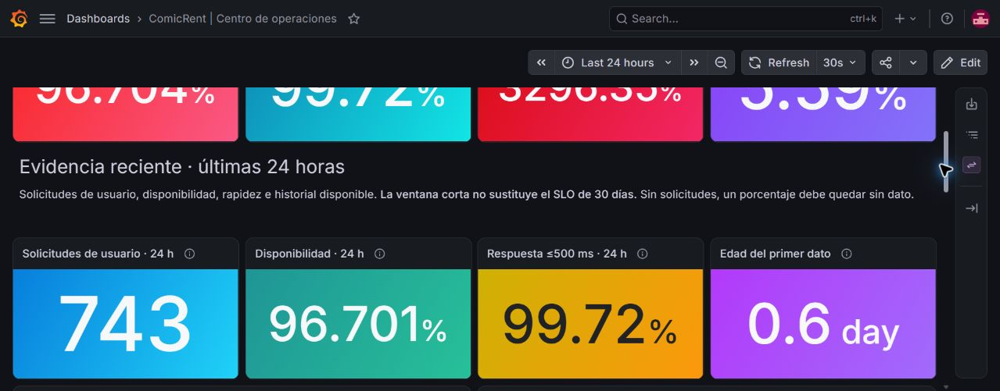
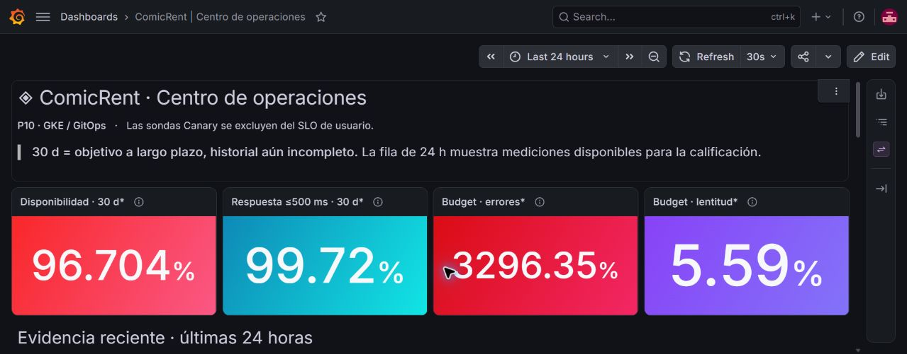
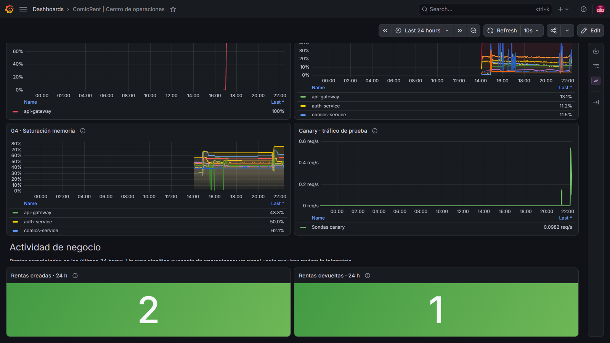

# Práctica 10 — Observabilidad y operación de ComicRent

Esta práctica amplía el clúster GitOps de P9 con métricas, trazas y registros correlacionados. ArgoCD despliega Prometheus, Alertmanager, Grafana, Loki, Tempo, Alloy y OpenTelemetry Collector; Argo Rollouts consulta métricas del candidato para decidir cada promoción. El incidente medido y el informe de operación ([PDF de una página](informe-operacion.pdf), [fuente Markdown](informe-operacion.md)) documentan el comportamiento real del sistema.

[Guía de calificación por criterio de la rúbrica](guia-calificacion.md).

## Tabla de enlaces obligatoria (sección 4.1)

| Ítem | Enlace o dato requerido |
|---|---|
| Repositorio de código | [Practicas-SA-B-202307705](https://github.com/DavidVelasquez77/Practicas-SA-B-202307705) |
| Repositorio GitOps | [Practicas-SA-B-202307705-gitops](https://github.com/DavidVelasquez77/Practicas-SA-B-202307705-gitops) |
| Servicios instrumentados | `api-gateway`, `rentals-service` y `copies-service` en `sa-p9`; `auth-service` también está instrumentado. [Código del gateway](../P4/api-gateway/src/observability/telemetry.ts), [rentas](../P4/services/rentals-service/app/observability.py), [copias](../P4/services/copies-service/app/observability.py). |
| Traza entre tres servicios | [Transacción verificada](evidence/three-service-transaction.md) y [traza Tempo](evidence/three-service-trace.json): `rentals-service` → `comics-service` y `copies-service`, un mismo `trace_id` en 14 spans. |
| Métricas de negocio | [`comicrent_rentals_created_total` y `comicrent_rentals_returned_total`](evidence/business-metrics-live.json), emitidas desde el arranque y aumentadas por operaciones reales de creación y devolución. |
| AnalysisTemplate por métricas | `api-gateway-metrics`, namespace `sa-p9`: [manifiesto GitOps](https://github.com/DavidVelasquez77/Practicas-SA-B-202307705-gitops/blob/main/apps/comicrent/templates/p10-analysis.yaml). |
| Publicación instrumentada | [GitHub Actions v0.9.2](https://github.com/DavidVelasquez77/Practicas-SA-B-202307705/actions/runs/38340568756) publicó cinco imágenes con Trivy, SBOM y Cosign; el [PR GitOps #27](https://github.com/DavidVelasquez77/Practicas-SA-B-202307705-gitops/pull/27) actualizó los tags. El [Rollout final](evidence/rollout-v0.9.2-healthy.json) quedó `Healthy` tras cuatro AnalysisRuns exitosos. |
| Consultas del análisis | [PromQL exacto para volumen, error y p95](#consultas-promql-del-canary); [plantilla GitOps](https://github.com/DavidVelasquez77/Practicas-SA-B-202307705-gitops/blob/main/apps/comicrent/templates/p10-analysis.yaml). |
| SLO declarados | [Disponibilidad ≥99.9% y latencia ≥95% de solicitudes ≤500 ms, ambos en 30 días móviles](slo/SLOs.md). |
| Reglas de alerta | [`PrometheusRule comicrent-slo-rules`](https://github.com/DavidVelasquez77/Practicas-SA-B-202307705-gitops/blob/main/apps/p10/observability/rules/slo-rules.yaml), con [runbook de disponibilidad](runbooks/availability-error-budget.md) y [runbook de latencia](runbooks/latency-error-budget.md). |
| Canal de alertas | La rama GitOps `feature/p10-observability` configura Alertmanager para enviar alertas SLO `warning`/`critical` al canal Discord `#alertas-p10`; el webhook se almacena como `SealedSecret`. La [prueba E2E](evidence/discord-alertmanager-e2e.md) entregó una alerta sintética y registró 1 envío exitoso, 0 fallos. La aplicación desplegada aún sigue `main`; la ruta quedará activa al integrar y sincronizar la rama. |
| Tablero | [JSON exportado de Grafana](dashboards/comicrent-operations.json), UID `comicrent-p10-operations`; [SLO y presupuesto](evidence/grafana-dashboard-final-slo.jpg), [24 h observadas](evidence/grafana-dashboard-fault-24h.jpg), [señales con colores diferenciados](evidence/grafana-dashboard-final-golden-signals.jpg) y [métricas de negocio](evidence/grafana-dashboard-business-live.png). |
| Reversión por métricas | [AnalysisRun `comicrent-api-gateway-rollout-cd956dbbc-15-1` (`Failed`)](evidence/public-canary-abort-analysisrun.json) del Rollout `comicrent-api-gateway-rollout`, namespace `sa-p9`. [Tráfico por Service público, aborto y recuperación](evidence/public-canary-traffic.md); [Rollout estable recuperado](evidence/public-canary-recovered-rollout.json). |
| Recorrido síntoma a causa | [Alerta → Prometheus → Loki → Tempo, máximo 1 min 16.93 s desde `firing`](evidence/block-7-canary-and-triage.md); [marcas medidas](evidence/block-7-signal-summary.json). |
| Video demostrativo | [Carpeta pública de Drive con el video](https://drive.google.com/drive/folders/1o23KFwNxf1ac2Y3ctkz1hr3OQOUZ1a3o?usp=sharing). Recorrido previsto: **7 min 15 s**; ajustar el minutaje si la grabación final distribuye los puntos de otra manera. |

> **Estado de entrega:** el enlace público lleva a la carpeta de Drive acordada y el minutaje previsto está en la tabla. Antes de calificar, confirmar que el video final esté dentro de esa carpeta y que el acceso público funcione.

## Flujo de telemetría



[Fuente editable del diagrama](diagrams/telemetry-flow.mmd). El tablero responde por orden a tráfico, latencia, errores y saturación; añade actividad de rentas y consumo de los dos presupuestos.









El tablero separa tráfico de usuarios y sondas controladas del Canary. Las tarjetas tienen colores diferenciados por función y las series usan gamas propias para tráfico, latencia, errores, CPU y memoria, con áreas degradadas para facilitar la lectura de tendencias. La fila «Evidencia reciente» muestra el **volumen y los dos indicadores de las últimas 24 horas**, más la edad del primer dato. Sirve para demostrar el cálculo durante la calificación del 17 de octubre sin fabricar un mes de observaciones; no reemplaza los dos SLO de 30 días. La vista de negocio usa contadores inicializados en cero y ya se verificó con una renta creada y otra devuelta. El simulacro público de Canary consumió presupuesto de disponibilidad, de modo que la ventana reciente **no aparece artificialmente en 100%** después de recuperarse. Prometheus retiene hasta 31 días en un volumen de 40 GiB; [criterio y límites de la demostración](slo/SLOs.md#demostración-antes-de-la-calificación-del-17-de-octubre).

## Consultas PromQL del canary

Las consultas están en el [AnalysisTemplate `api-gateway-metrics`](https://github.com/DavidVelasquez77/Practicas-SA-B-202307705-gitops/blob/main/apps/comicrent/templates/p10-analysis.yaml). `HASH` representa el argumento `rollout-hash` de la revisión candidata. Se evalúan sobre los últimos cinco minutos y se exige volumen ≥20 para evitar una decisión basada en una sola solicitud fría.

En la configuración P10, el Service público selecciona tanto el ReplicaSet estable como el candidato; Argo Rollouts aproxima los pesos mediante el número de réplicas. Con solo tres réplicas, `10%` y `25%` son objetivos de promoción, **no porcentajes exactos de tráfico**. El análisis filtra `traffic_source="user"`, de modo que las sondas marcadas como Canary no deciden la promoción. [Prueba por el Service público](evidence/public-canary-traffic.md).

```promql
# Volumen: se promociona únicamente con al menos 20 solicitudes recientes.
sum(increase(comicrent_http_requests_total{namespace="sa-p9",service="api-gateway",traffic_source="user",rollouts_pod_template_hash="HASH"}[5m])) or vector(0)

# Errores 5xx y timeout / solicitudes del candidato: debe ser <= 0.001.
(sum(increase(comicrent_http_requests_total{namespace="sa-p9",service="api-gateway",traffic_source="user",rollouts_pod_template_hash="HASH",status_class=~"5xx|timeout"}[5m])) / clamp_min(sum(increase(comicrent_http_requests_total{namespace="sa-p9",service="api-gateway",traffic_source="user",rollouts_pod_template_hash="HASH"}[5m])), 1)) or vector(0)

# p95 de latencia del candidato: debe ser <= 0.5 segundos.
histogram_quantile(0.95, sum by (le) (rate(comicrent_http_request_duration_seconds_bucket{namespace="sa-p9",service="api-gateway",traffic_source="user",rollouts_pod_template_hash="HASH"}[5m]))) or vector(0)
```

El fallo de P10 fue una URL de autenticación inválida en la revisión candidata. En la [prueba corregida por el Service público](evidence/public-canary-traffic.md), el cliente recibió `401` de la versión estable y `502` del candidato. Prometheus midió tasa de error candidata `1.0`; el AnalysisRun falló y Argo Rollouts abortó sin intervención. La versión estable conservó sus tres réplicas. El tráfico lo generó un cliente de demostración, no usuarios espontáneos; la diferencia con el antiguo Job sintético es que la decisión consulta los **contadores HTTP observados en el candidato**, filtrados a solicitudes sin cabecera de sonda.

## Video demostrativo

Duración requerida: 5–8 minutos. El video se publicará en la [carpeta pública de Drive de P10](https://drive.google.com/drive/folders/1o23KFwNxf1ac2Y3ctkz1hr3OQOUZ1a3o?usp=sharing). Este es el recorrido previsto de **7 min 15 s**; ajustar el minutaje de la tabla a la grabación final.

| Minutaje previsto | Qué mostrar |
|---|---|
| 0:00–0:45 | ArgoCD: aplicaciones GitOps de observabilidad `Synced/Healthy` y servicios instrumentados. |
| 0:45–1:45 | Prometheus: métricas de los tres servicios, dos métricas de negocio, reglas SLI y presupuestos. |
| 1:45–2:45 | Grafana: tablero con las cuatro señales de oro y SLO de 30 días. |
| 2:45–3:45 | AnalysisTemplate: volumen, error y p95 de la revisión candidata en PromQL. |
| 3:45–5:00 | AnalysisRun fallido, evento `RolloutAborted` y ReplicaSet estable. |
| 5:00–6:30 | Alerta `ComicRentAvailabilityBudgetFastBurn`, ruta afectada, registro JSON en Loki y `trace_id` en Tempo. |
| 6:30–7:15 | Informe: tiempos medidos, recuperación GitOps y separación ya implementada entre tráfico de usuario y sondas Canary. |
