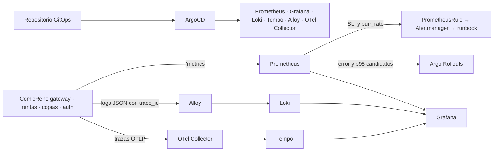

# Práctica 10 — Observabilidad y operación de ComicRent

Esta práctica amplía el clúster GitOps de P9 con métricas, trazas y registros correlacionados. ArgoCD despliega Prometheus, Alertmanager, Grafana, Loki, Tempo, Alloy y OpenTelemetry Collector; Argo Rollouts consulta métricas del candidato para decidir cada promoción. El incidente medido y el informe de operación ([PDF de una página](informe-operacion.pdf), [fuente Markdown](informe-operacion.md)) documentan el comportamiento real del sistema.

## Tabla de enlaces obligatoria (sección 4.1)

| Ítem | Enlace o dato requerido |
|---|---|
| Repositorio de código | [Practicas-SA-B-202307705](https://github.com/DavidVelasquez77/Practicas-SA-B-202307705) |
| Repositorio GitOps | [Practicas-SA-B-202307705-gitops](https://github.com/DavidVelasquez77/Practicas-SA-B-202307705-gitops) |
| Servicios instrumentados | `api-gateway`, `rentals-service` y `copies-service` en `sa-p9`; `auth-service` también está instrumentado. [Código del gateway](../P4/api-gateway/src/observability/telemetry.ts), [rentas](../P4/services/rentals-service/app/observability.py), [copias](../P4/services/copies-service/app/observability.py). |
| AnalysisTemplate por métricas | `api-gateway-metrics`, namespace `sa-p9`: [manifiesto GitOps](https://github.com/DavidVelasquez77/Practicas-SA-B-202307705-gitops/blob/feature/p10-observability/apps/comicrent/templates/p10-analysis.yaml). |
| Consultas del análisis | [PromQL exacto para volumen, error y p95](#consultas-promql-del-canary); [plantilla GitOps](https://github.com/DavidVelasquez77/Practicas-SA-B-202307705-gitops/blob/feature/p10-observability/apps/comicrent/templates/p10-analysis.yaml). |
| SLO declarados | [Disponibilidad ≥99.9% y latencia ≥95% de solicitudes ≤500 ms, ambos en 30 días móviles](slo/SLOs.md). |
| Reglas de alerta | [`PrometheusRule comicrent-slo-rules`](https://github.com/DavidVelasquez77/Practicas-SA-B-202307705-gitops/blob/feature/p10-observability/apps/p10/observability/rules/slo-rules.yaml), con [runbook de disponibilidad](runbooks/availability-error-budget.md) y [runbook de latencia](runbooks/latency-error-budget.md). |
| Tablero | [JSON exportado de Grafana](dashboards/comicrent-operations.json), UID `comicrent-p10-operations`. La captura en operación se incorporará a `evidence/` tras iniciar sesión en Grafana. |
| Reversión por métricas | [AnalysisRun `comicrent-api-gateway-rollout-b544dbdd9-9-1` (`Failed`)](evidence/block-7-analysisrun.json) del Rollout `comicrent-api-gateway-rollout`, namespace `sa-p9`; [secuencia](evidence/block-7-canary-and-triage.md) y [estado estable recuperado](evidence/block-8-rollout-recovery.json). |
| Recorrido síntoma a causa | [Alerta → Prometheus → Loki → Tempo, máximo 1 min 16.93 s desde `firing`](evidence/block-7-canary-and-triage.md); [marcas medidas](evidence/block-7-signal-summary.json). |
| Video demostrativo | Pendiente de grabación y enlace público directo. El [minutaje propuesto](#video-demostrativo) se sustituirá por el real tras grabarlo. |

> **Estado de entrega:** faltan la captura del tablero en operación y la URL pública directa del video. La fila del video debe completarse antes de calificar; el enunciado asigna cero a enlaces ausentes o que requieran autenticación.

## Flujo de telemetría



[Fuente editable del diagrama](diagrams/telemetry-flow.mmd). El tablero responde por orden a tráfico, latencia, errores y saturación; añade actividad de rentas y consumo de los dos presupuestos.

## Consultas PromQL del canary

Las consultas están en el [AnalysisTemplate `api-gateway-metrics`](https://github.com/DavidVelasquez77/Practicas-SA-B-202307705-gitops/blob/feature/p10-observability/apps/comicrent/templates/p10-analysis.yaml). `HASH` representa el argumento `rollout-hash` de la revisión candidata. Se evalúan sobre los últimos cinco minutos y se exige volumen ≥20 para evitar una decisión basada en una sola solicitud fría.

```promql
# Volumen: se promociona únicamente con al menos 20 solicitudes recientes.
sum(increase(comicrent_http_requests_total{namespace="sa-p9",service="api-gateway",rollouts_pod_template_hash="HASH"}[5m])) or vector(0)

# Errores 5xx y timeout / solicitudes del candidato: debe ser <= 0.001.
(sum(increase(comicrent_http_requests_total{namespace="sa-p9",service="api-gateway",rollouts_pod_template_hash="HASH",status_class=~"5xx|timeout"}[5m])) / clamp_min(sum(increase(comicrent_http_requests_total{namespace="sa-p9",service="api-gateway",rollouts_pod_template_hash="HASH"}[5m])), 1)) or vector(0)

# p95 de latencia del candidato: debe ser <= 0.5 segundos.
histogram_quantile(0.95, sum by (le) (rate(comicrent_http_request_duration_seconds_bucket{namespace="sa-p9",service="api-gateway",rollouts_pod_template_hash="HASH"}[5m]))) or vector(0)
```

El fallo de P10 fue una URL de autenticación inválida en la revisión candidata. Prometheus midió tasa de error `1.0`; el AnalysisRun falló y Argo Rollouts abortó sin intervención. La versión estable conservó sus tres réplicas. [Evidencia completa](evidence/block-7-canary-and-triage.md).

## Video demostrativo

Duración requerida: 5–8 minutos. Este es el recorrido propuesto; al publicar el archivo se ajustarán los minutos a la grabación real y se pondrá su URL directa en la tabla.

| Minutaje previsto | Qué mostrar |
|---|---|
| 0:00–0:45 | ArgoCD: aplicaciones GitOps de observabilidad `Synced/Healthy` y servicios instrumentados. |
| 0:45–1:45 | Prometheus: métricas de los tres servicios, dos métricas de negocio, reglas SLI y presupuestos. |
| 1:45–2:45 | Grafana: tablero con las cuatro señales de oro y SLO de 30 días. |
| 2:45–3:45 | AnalysisTemplate: volumen, error y p95 de la revisión candidata en PromQL. |
| 3:45–5:00 | AnalysisRun fallido, evento `RolloutAborted` y ReplicaSet estable. |
| 5:00–6:30 | Alerta `ComicRentAvailabilityBudgetFastBurn`, ruta afectada, registro JSON en Loki y `trace_id` en Tempo. |
| 6:30–7:15 | Informe: tiempos medidos, recuperación GitOps y mejora propuesta. |
